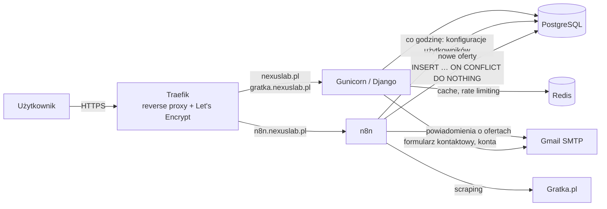

# NexusLab


Kod strony **[nexuslab.pl](https://nexuslab.pl)** — portfolio automatyzacji i aplikacji z AI — oraz produktu
**[Gratka Alerts](https://gratka.nexuslab.pl)**: wielodostępowego systemu, który co godzinę monitoruje oferty
nieruchomości na Gratka.pl i wysyła użytkownikom powiadomienia o nowych ogłoszeniach spełniających ich kryteria.

## Funkcje

**nexuslab.pl — portfolio**
- Projekty, automatyzacje n8n, opinie klientów, FAQ
- Formularz kontaktowy (HTMX) z wysyłką maila, honeypotem i limitem zgłoszeń na IP
- SEO: meta tagi, Open Graph, dane strukturalne JSON-LD (`ProfessionalService`, `FAQPage`)

**Gratka Alerts — `gratka.nexuslab.pl`**
- Konfiguracja kryteriów: lokalizacja, cena, metraż, balkon, garaż, piwnica
- Scraper w n8n uruchamiany co godzinę, deduplikacja ofert na poziomie bazy
- Powiadomienia email o nowych ofertach
- Konta użytkowników (django-allauth), 7-dniowy trial i plany subskrypcyjne
- Izolacja danych między użytkownikami (row-level, filtrowanie po `user_id`)

## Architektura



- Jedna aplikacja Django obsługuje obie domeny — `SubdomainMiddleware` przełącza urlconf dla `gratka.*`.
- `SubscriptionMiddleware` blokuje dostęp do Gratka Alerts po wygaśnięciu trialu.
- Pliki statyczne serwuje WhiteNoise.

## Stack

| Warstwa | Technologie |
|---|---|
| Backend | Python, Django 5.0, django-allauth, Celery |
| Frontend | HTMX, Alpine.js, Tailwind CSS — renderowanie po stronie serwera |
| Dane | PostgreSQL 16, Redis |
| Automatyzacja | n8n (self-hosted) |
| Infrastruktura | VPS (Ubuntu), Traefik, Gunicorn, Supervisor, Docker (n8n, Traefik) |

## Struktura

```
apps/
├── website/        # portfolio nexuslab.pl + formularz kontaktowy
├── gratka/         # panel Gratka Alerts
├── subscriptions/  # plany, trial, blokada dostępu
├── accounts/       # uwierzytelnianie (django-allauth)
├── chatbot/        # placeholder
└── dashboard/      # placeholder
config/
├── settings/       # base.py, production.py
├── middleware.py   # SubdomainMiddleware, SubscriptionMiddleware
├── urls.py         # nexuslab.pl
└── urls_gratka.py  # gratka.nexuslab.pl
templates/          # szablony (UI po polsku)
static/             # obrazy
```

## Uruchomienie lokalne

Wymagania: Python 3.11+, PostgreSQL, Redis.

```bash
python3.11 -m venv venv
source venv/bin/activate
pip install -r requirements.txt

cp .env.example .env          # uzupełnij dane bazy i SMTP
python manage.py migrate
python manage.py createsuperuser
python manage.py runserver
```

Celery jest skonfigurowany (broker: Redis) pod przyszłe zadania w tle:

```bash
celery -A config worker --loglevel=info
celery -A config beat --loglevel=info
```

## Wdrożenie

`deploy.sh` na serwerze: `git pull` → `pip install` → `migrate` → `collectstatic` → restart procesów w Supervisorze.
Konfiguracje Supervisora są w `deploy/`.

---

Autor: **Zbigniew Szafrański** · [nexuslab.pl](https://nexuslab.pl) · [kontakt@nexuslab.pl](mailto:kontakt@nexuslab.pl)
